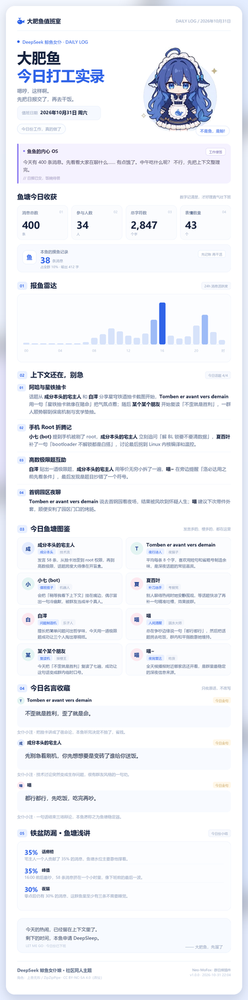

> **2.0.0**：只保留自挂页面的独立 WebUI（/plugins/group-daily-log/），不再接入官方 Plugin UI，也不依赖 
eo-mofox-webui。/日报 命令与定时投递不变。

# 群日报 · Daily Log

把群聊一天的内容整理成一张可以直接发群的长图海报：消息统计、24 小时活跃度、
今日话题、群友图鉴、今日名言、数据小结，一条不缺。

面向 [Neo-MoFox](https://github.com/MoFox-Studio/Neo-MoFox) 插件系统开发，
按 `docs/development/plugin_develop` 的公开入口与组件契约实现；不依赖浏览器、
不依赖外部渲染服务，海报由 Pillow 直接绘制。



## 功能

- **每天定时投递**：到点自动统计当天消息、生成海报并发送到配置的群。
- **手动补发**：`/日报`、`/日报 2026-10-30`、`/日报 昨天`。
- **只出图不发送**：`/日报 预览`，方便调排版。
- **LLM 结构化文案**：一次请求生成话题、群友图鉴、名言点评与数据洞察。
- **模型不可用也能出图**：自动回退到基于统计与原始消息的规则版文案。
- **本地留档**：PNG 与 JSON 存在 `data/group_daily_log/reports/`，按天数自动清理。
- **可换立绘**：`poster.character_path` 支持绝对路径或插件内相对路径。
- **WebUI 页面**：按官方 Plugin UI 规范注册「群日报」页面，历史画廊、预览、选群补发。

## 安装

1. 把整个 `group_daily_log/` 目录放进 Neo-MoFox 的 `plugins/` 下，或用 MPDT
   打包成 `.mfp` 后放入 `plugins/`。
2. 确认运行环境有 Pillow：

   ```bash
   uv add pillow
   ```

3. 启动机器人。首次加载会在 `config/plugins/group_daily_log/config.toml`
   生成默认配置。
4. 在配置里填 `general.groups`（群号）和 `general.send_time`（发送时间），
   重载插件即可。
5. 本插件依赖官方 WebUI 插件 `neo-mofox-webui`（Plugin UI），未安装时加载器会跳过本插件；
   安装后重载，WebUI 的「插件中心」会出现「群日报」页面。

## 配置

```toml
[general]
enabled = true
timezone = "Asia/Shanghai"
platform = "qq"
groups = ["123456789"]
group_aliases = ["123456789=大肥鱼值班室"]
send_time = "23:30"
auto_send = true
check_interval_seconds = 60
command_permission = "user"

[analysis]
model_task = "utils"          # config/model.toml 里的 model_tasks 名称
max_messages = 1200           # 送进提示词的消息上限（超出会均匀抽样）
message_char_limit = 160
transcript_budget = 24000
topic_count = 4
member_count = 8
quote_count = 3
include_bot = true
persona = "你是群里的机器鱼「大肥鱼」……"
custom_prompt = ""

[poster]
room_name = "大肥鱼值班室"
bot_name = "大肥鱼"
page_title = "今日打工实录"
subtitle_lines = ["嗯哼，这样啊。", "先把日报交了，再去干饭。"]
character_path = ""
show_character = true
brand_text = "DeepSeek 鲸鱼女仆娘 · 社区同人主题"
credit_text = "角色：上香无形 / ZipZipPipe · CC BY-NC-SA 4.0（改绘）"
footer_note = "Neo-MoFox · 群日报插件"

[storage]
keep_days = 30

[webui]
enabled = true
page_title = "群日报"
page_order = 60
default_limit = 30
```

要点：

- `groups` 为空时不会定时发送，但 `/日报` 仍然可用。
- `group_aliases` 用来给每个群一个体面的标题，格式 `群号=群名`。
- `send_time` 早于 `06:00` 时，统计的是**前一天**的聊天记录。
- `model_task` 指向 `config/model.toml` 的 `model_tasks`，默认用 `utils`；
  没配模型或调用失败会自动回退，不会卡住出图。

## 使用

| 命令 | 说明 |
| --- | --- |
| `/日报` | 生成并发送今天的日报 |
| `/日报 2026-10-31` | 指定日期 |
| `/日报 10-31` | 省略年份 |
| `/日报 昨天` | 昨天 |
| `/日报 预览` | 只生成 PNG，不发送 |
| `/日报 重做` | 忽略旧图，重新生成并发送 |

命令权限由 `general.command_permission` 控制（`guest` / `user` / `operator` / `owner`）。

## WebUI 页面（官方 Plugin UI）

按 Neo-MoFox 官方 Plugin UI 规范接入：`manifest.json` 的
`dependencies` 声明 `neo-mofox-webui` 与
`neo-mofox-webui:service:plugin_ui`，插件类同步声明 `dependent_components`。
启动时通过 `get_service()` 取得 `plugin_ui` 服务并注册页面，卸载时调用
`unregister_plugin_pages()` 清理。

页面出现在 WebUI 的「插件中心 → 群日报」：

- 历史日报画廊，按日期倒序，标出群名、体积与生成时间；
- 点任意一条即可预览长图，不用先去群里翻记录；
- 选群、选日期，一键「生成并发送」或「仅生成」；
- 顶部显示已生成数量与最近一期。


页面资源放在 `ui/`（官方示例的目录约定），HTML 轨 + Shadow DOM；
脚本优先用 `sys.request` 调后端（自动注入 Token、解包 BaseResponse），
提示走 `sys.ui.toast`，宿主选择器同时兼容 `.html-sandbox-host`（官方）
与 `.html-sandbox-wrapper`（旧版）。

> 因为 `dependencies.plugins` 声明了 `neo-mofox-webui`，加载器会把它排在本插件之前；
> 如果实例里没有安装官方 WebUI 插件，本插件会被判为「依赖插件不可用」而跳过加载。

接口（`/webui/api/group-daily-log`）：

| 方法 | 路径 | 说明 |
| --- | --- | --- |
| GET | `/state` | 群列表、已生成数量、最近一期 |
| GET | `/reports?limit=30` | 历史日报索引 |
| GET | `/image/{slug}/{date}.png` | 海报原图 |
| POST | `/generate` | `{group_id, date, send, regenerate}` 生成 / 补发 |

响应统一为 `{code, message, data}`（BaseResponse 形状），既方便 `sys.request`
自动解包，也方便 curl 调试。直接调接口时需要带
`X-API-Key: <config/core.toml 里 http_router.api_keys 的任一值>`。

## 工作原理

```text
MessageAPI 读当天消息
      │
      ├─ split_bot_messages() 区分真人与机器人
      ├─ compute_stats()      统计条数/人数/字数/表情/24h 分布/话痨榜
      └─ build_transcript()   按预算拼聊天记录
      │
analyze_day() ── LLM 结构化 JSON ──┐
      │                             ├─ 校验：昵称必须在场、原话必须真实存在
      └─ 失败/超时/坏 JSON ── 规则回退 ┘
      │
PosterRenderer (Pillow, 2x 超采样) → PNG + JSON → send_image(base64)
```

模块划分：

| 文件 | 职责 |
| --- | --- |
| `plugin.py` | 插件入口、定时任务注册、发送状态持久化 |
| `config.py` | `BaseConfig` 配置节 |
| `service.py` | 生成/发送编排、留档与清理 |
| `command.py` | `/日报` 命令与日期解析 |
| `collector.py` | 消息读取、抽样、统计、逐字稿、金句候选 |
| `analyzer.py` | 提示词、JSON 校验、规则回退 |
| `render.py` | 海报布局与绘制 |
| `models.py` | 数据模型与文本清洗 |
| `reports.py` | 产物路径、历史索引，供 Service 与 Router 共用 |
| `webui_api.py` | `DailyLogRouter`，WebUI 的读取与补发接口 |
| `webui_page.py` | 向 WebUI 注册 / 注销页面 |
| `ui/` | 页面 HTML、CSS、JS（官方 Plugin UI 资源目录） |

## 无模型时的回退

`analyze_day()` 在以下情况会走规则版文案：

- 模型任务不存在或没有可用模型；
- 请求超时、限流、返回非 JSON；
- JSON 缺少话题或群友图鉴。

回退版仍然使用真实统计与真实原话，只是话题按「凌晨 / 上午 / 下午 / 晚上」
分段，群友称号按发言量生成，不会编造数据。

## 素材与授权

内置立绘来自社区同人主题，署名见海报页脚：

- 角色：上香无形 / ZipZipPipe，CC BY-NC-SA 4.0（改绘）。

如果要商用或二次分发，请先确认素材授权，或把 `poster.character_path`
指向自己的立绘并把 `credit_text` 改成对应署名。

## 视觉参考

版式参考了 AstrBot 社区「群分析总结」类日报海报（`Template by StuGRua`），
本仓库是针对 Neo-MoFox 插件规范重写的实现：数据来自 Neo-MoFox 消息库，
文案与渲染完全本地完成，不依赖 AstrBot 运行时。

## 开发与测试

```bash
# 语法与静态导入
python -m compileall group_daily_log

# 单元测试（纯逻辑 + 渲染冒烟）
pytest tests -q -p no:cacheprovider

# 不启动机器人，直接生成一张演示海报
python scripts/demo_render.py
```

测试覆盖：文本清洗、统计口径、抽样、逐字稿预算、金句过滤、
JSON 校验与回退、渲染尺寸、产物路径与历史索引、WebUI Router 装配与基础响应、
插件生命周期中的页面注册/注销（用假插件 + 假 Plugin UI 服务，不启动机器人）。

## 已知限制

- 只统计文本消息的字数与表情，图片/语音按占位符计一条，不做内容识别。
- 群名来自 `group_aliases` / `poster.room_name`，不会主动读群资料。
- 机器人与真人的区分依赖当前已连接的适配器；适配器离线时机器人消息会算进真人统计。
- 定时检查精度取决于 `check_interval_seconds`（默认 60 秒）。
- WebUI 页面依赖官方 `neo-mofox-webui` 的 Plugin UI 服务；manifest 已声明插件依赖，
  没有安装该插件时本插件不会被加载。核心没配 `http_router.api_keys`
  时 WebUI 无法登录，本插件的接口也会按 `X-API-Key` 规则拒绝请求。
- WebUI 里点「生成并发送」会同步等待一次完整生成（首次通常 20–60 秒），
  期间按钮会禁用，属预期行为。

## 版本

- `1.2.0`：按官方 Plugin UI 规范补全依赖声明（manifest + `dependent_components`）、
  改用 `ui/` 资源目录与 `sys.request` / BaseResponse 响应、批量注销页面。
- `1.1.0`：接入 Neo-MoFox WebUI（历史画廊 / 预览 / 补发）、新增 Router 与页面、
  抽出 `reports.py` 统一产物路径、补充 Router 与路径测试。
- `1.0.0`：初版，定时投递 + `/日报` + Pillow 海报。


## 许可

- **代码**：MIT（见 `LICENSE`）
- **立绘素材** `assets/whale_maid.png`：CC BY-NC-SA 4.0（上香无形 / ZipZipPipe 改绘），
  必须在海报页脚保留署名，不得商用；这一条不适用 MIT。
- 插件图标 `icon.png` 由立绘裁切而来，同样适用素材许可。
